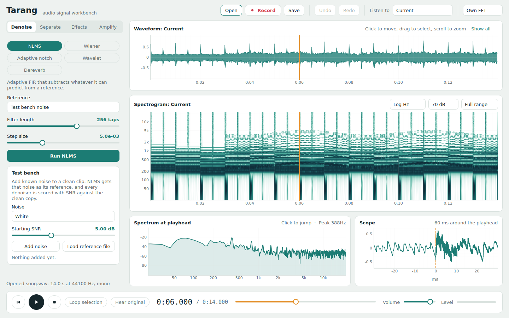

# EchoX — audio signal workbench

Denoise, separate, reshape and amplify audio with classic DSP, while watching
the signal in the time and frequency domain in real time. Every transform
(FFT, real FFT, STFT, DWT) is written by hand in `echox/dsp/`; numpy.fft is
only an optional comparison engine.



## Run

```bash
pip install -r requirements.txt
python main.py                      # empty window: drag a file in or press Ctrl+O
python main.py docs/demo_song.wav             # bundled 14 s music mix
python main.py docs/demo_varying_noise.wav    # speech with fan -> TV -> radio noise
python main.py docs/street_noisy.wav          # real voice, noise from the start
python main.py docs/street_late_noisy.wav     # same scene, clean until 9 s, then noise
python main.py docs/bird_mix.wav              # two bird species in separate bands
python tests/test_dsp.py            # 13 checks, about 2 s
```

On Windows use the py launcher (`py -3.14 -m pip install -r requirements.txt`,
then `py -3.14 main.py`) so the install does not land on an MSYS2 Python, which
has no ready wheels for scipy or PySide6.

- **macOS / Windows**: the pip wheels of sounddevice and soundfile already carry
  PortAudio and libsndfile. Nothing else is needed for wav, flac, ogg, mp3, aiff.
- **Linux**: `sudo apt install libportaudio2` for playback and recording.
- **m4a / aac / wma**: decoded through ffmpeg when it is installed.

## Features

| Section  | Algorithms |
|----------|------------|
| Denoise  | Wiener (STFT, decision-directed, noise profile that tracks changing noise, optional second pass), adaptive notch (with automatic tone finding), wavelet shrinkage, click remover, dereverb (WPE or spectral subtraction) |
| Separate | REPET (voice vs repeating background), Instruments (HPSS for sustained-vs-percussive, or NMF part-grouping for two instruments sharing a frequency range), NMF (unsupervised or trained on a selection), Frequency split (sources living in separate bands — bird species, a whistle over speech) |
| Effects  | filters (low-pass, high-pass, band-pass, band-stop), echo and reverb, 7-band equaliser, Doppler, reverse, speed change (pitch kept via a phase-locked vocoder, or moved via resampling), mix in a second file (background music under a voice, or the reverse, with optional looping and ducking), concatenate a second file, trim or crop to the selection |
| Amplify  | gain, peak / RMS normalise, compressor, soft limiter |

Live recording draws the waveform and a rolling spectrogram while you record.
A test bench adds known noise to a clean clip and scores every denoiser in dB SNR.

## Listening and navigation

| Action                                  | Effect |
|-----------------------------------------|--------|
| **Original** button, or **Tab**         | A/B the working copy against the file you loaded, keeping the playhead |
| Speed button (0.5x - 2x)                | playback speed with the pitch unchanged (phase-locked vocoder with transient reset, rendered in the background); the file itself is untouched |
| Volume slider (0 - 200 %)               | above 100 % a soft knee holds the peaks at -1 dBFS, so a quiet recording gets louder without crackling |
| "Listen to" box                         | play the original, the current signal, or any separated stem |
| Click waveform or spectrogram           | move the playhead there |
| Click a frequency in *Spectrum*         | jump to the next moment that band (±1 semitone) gets loud; click again for the one after |
| Move the mouse over a view              | read out time, frequency and level under the cursor |
| Drag                                    | select a region |
| Right click / Esc                       | clear selection |
| Mouse wheel / Shift + drag              | zoom / pan the time axis |
| Space / Home                            | play-pause / go to start |
| Ctrl+R / Ctrl+O / Ctrl+S                | record / open / save |
| Ctrl+Z / Ctrl+Shift+Z                   | undo / redo |

The spectrogram header sets the frequency scale (log by default, so the low
octaves get their share of the screen), the contrast (50-110 dB below the
loudest content) and the top frequency.

The selection is shared: Wiener uses it as the noise profile, NMF learns the
accompaniment from it, Amplify and Reverse can work on it alone, and
"Loop selection" plays it.

## Mixing two files (voice + background music)

Load the file you're working on as usual, then click **Load second file**
(below the Denoise algorithm list) to bring in the other one - a music bed, a
sound effect, a second voice. It loads once and stays available from every
section:

- **Denoise -> Wiener**, noise profile "Noise file": uses it as a noise profile.
- **Effects -> Mix in a file**: adds it into the current signal at a chosen
  level (dB), start time, with an optional loop to cover the whole clip, and
  an optional "duck" that turns the current signal down while the second file
  plays - handy for lowering background music under narration.

`docs/voice_plus_music.wav` is `harvard.wav` (the sample voice) with
`demo_song.wav` mixed in at -10 dB, looped to fill the clip.

## Filters and room effects

**Effects → Filter** builds Butterworth sections through the bilinear
transform and runs them as biquads: low-pass, high-pass, band-pass, band-stop.
Zero phase runs the cascade forwards and backwards, so there is no phase shift
and the slope doubles. Measured on white noise, order 4, zero phase:

| Type | passband | stopband |
|------|---------:|---------:|
| Low-pass 1 kHz | −0.0 dB at 200–400 Hz | −45.3 dB at 4–6 kHz |
| High-pass 1 kHz | −0.0 dB at 4–6 kHz | −29.7 dB at 200–400 Hz |
| Band-pass 0.5–2 kHz | −0.8 dB at 0.8–1.2 kHz | −45.9 dB at 4–6 kHz |
| Band-stop 0.5–2 kHz | −1.3 dB at 4–6 kHz | −30.4 dB at 0.8–1.2 kHz |

**Effects → Echo / Reverb** is the counterpart of the Dereverb tool. Echo is a
feedback comb with a damped loop, so each repeat returns quieter and duller
(feedback 0.5, damping off: repeats measured at 1.0, 0.5, 0.25). Reverb is a
Schroeder network — four mutually prime combs for density, two all-passes to
smear the tail.

## Editing: trim, crop, concatenate

- **Effects -> Trim (cut out)**: removes the selected region and joins what is
  left, with a short fade on each side of the join so there is no click.
- **Effects -> Crop (keep only)**: keeps only the selected region, drops the
  rest.
- **Effects -> Concatenate**: joins the loaded second file onto this one
  (before or after), with an optional crossfade instead of a hard splice.

All three are exact array operations away from the fades: `fx.trim`/`fx.crop`
with `fade_ms=0` reproduce a plain slice-and-join to sample accuracy (checked
in `tests/test_dsp.py`).

## Hand-written transforms

| Module | What is inside |
|--------|----------------|
| `dsp/transforms.py` | iterative radix-2 DIT FFT (bit reversal + butterflies, numba), real FFT via even/odd packing into one N/2-point complex FFT, Bluestein chirp-z for other lengths, Hann STFT and weighted overlap-add ISTFT |
| `dsp/wavelets.py`   | orthogonal periodized DWT / IDWT filter bank with mirrored edges, soft/hard threshold; only the published filter coefficients are stored |

The header combo **Own FFT / NumPy FFT** (or `ECHOX_FFT=numpy python main.py`)
switches every algorithm and view between the two engines.

| Check (see `tests/test_dsp.py`) | Result |
|---------------------------------|--------|
| FFT vs numpy, n = 4096          | max error 1.2e-13 |
| STFT vs scipy.signal.stft       | max error 9e-17 |
| ISTFT(STFT(x)) round trip       | 3e-15 |
| DWT round trip, all 5 wavelets  | ≤ 1.6e-12 |
| STFT of 14 s at 44.1 kHz        | own 64 ms, scipy 34 ms |

## Which tool for which sound

`docs/GUIDE.md` is the measured answer: ten purpose-built test clips in
`docs/testsounds/` (each with its clean reference), every method run against
every clip, and a short reading of what the numbers mean. The short version:

| Problem | Use |
|---------|-----|
| steady hiss, fan, traffic | Wiener (Second pass for a little more) |
| noise that changes during the clip | Wiener, Tracking profile |
| clicks, taps, hammering | Click remover (nothing else touches them) |
| hum, coil whine, buzz | Dereverb WPE for the strongest removal, Notch to take only that tone |
| room reverb | Dereverb WPE |
| sources in separate frequency bands | Frequency split |
| instruments vs drums | Instruments, HPSS mode |
| two instruments in the same pitch range | Instruments, NMF grouping mode |
| singing over a repeating backing track | REPET, or NMF trained on a selection |
| a recording that is simply too quiet | Amplify: compressor + RMS target + limiter |

## Measured results

SNR in dB against the known clean signal. Song = the bundled 14 s synthetic mix
at 44.1 kHz; speech = 6 s voiced signal with pauses at 16 kHz.

**Denoise** (input SNR 5.0 dB, default parameters)

| Clip   | Noise       | Wiener | Wiener + 2nd pass | Notch | Wavelet |
|--------|-------------|-------:|------------------:|------:|--------:|
| song   | White       | 11.3   | 11.8              | 3.8   | 12.4    |
| song   | Pink        | 7.8    | 7.6               | 3.8   | 6.7     |
| song   | Hum 50 Hz   | 5.3    | 5.3               | 8.1   | 5.0     |
| song   | Fan (brown) | 5.8    | 5.7               | 4.0   | 5.0     |
| speech | White       | 15.5   | 16.2              | 3.2   | 12.2    |
| speech | Pink        | 12.2   | 12.5              | 3.5   | 5.7     |
| speech | Hum 50 Hz   | 16.1   | 16.1              | 6.8   | 5.0     |
| speech | Fan (brown) | 11.3   | 11.4              | 3.5   | 5.0     |

**Real voice outdoors, noise starting mid-file** (`docs/street_late_noisy.wav`:
the same street scene as above, but the first 9 s are the clean recording and
the noise (traffic, a car pass-by, a horn, babble, hammering) only begins at
9 s; SNR of the noisy half is 5.0 dB). `street_late_clean.wav` is the dry
voice for comparison.

| Method | Quiet half (0-9 s) | Noisy half (9-18 s) |
|--------|--------------------:|---------------------:|
| input | (clean) | 5.00 |
| Wiener, one profile for the whole clip | 41.6 (unaffected) | 5.01 |
| **Wiener, tracking (the default here)** | 18.1 | **7.74** |
| declick, then Wiener tracking | 15.3 | **8.80** |

The tracking window costs a little on the clean half — it briefly treats the
first second of new noise as part of the signal while it catches up, so that
half drops from ~48 dB (a fixed profile leaves it untouched) to ~18 dB, still
far cleaner than the noisy half ever gets. The noisy half is what matters here,
and it is the one a mid-file noise onset is testing.

**Real voice outdoors** (`docs/street_noisy.wav`: a real 18 s recording mixed with
traffic rumble, wind gusts, a car passing with real Doppler, two horns, crowd
babble, birds and hammering; input SNR 5.0 dB). `street_clean.wav` is the dry
voice, so the numbers can be reproduced.

| Method | SNR |
|--------|----:|
| wavelet shrinkage | 5.0 (unchanged) |
| dereverb (WPE) | 5.3 |
| fixed profile from the first 0.6 s | 6.0 |
| one profile for the whole clip | 6.3 |
| **Wiener, tracking profile (the default here)** | **8.3** |
| Wiener + second pass | 8.3 |

Only about +3.3 dB, and that is the honest ceiling: half of this scene is crowd
babble, which no single-microphone method can separate from the voice being kept.
The quiet stretches improve far more than the busy ones (per 3 s: 7.2, 11.6, 6.5,
14.8, 7.5, 3.1 dB).

Applying the same gain to each source separately shows what a spectral method
can and cannot reach. A noise floor has to last about a second in a bin before
the estimator believes it, so anything shorter passes straight through:

| Source in the scene | Share of the noise | Wiener | Click remover, then Wiener |
|---------------------|------------------:|-------:|---------------------------:|
| traffic rumble (whole clip) | 43 % | −8.6 dB | −9.1 dB |
| car passing (4.5-9 s)       | 24 % | −12.3 dB | −12.4 dB |
| crowd babble (8-18 s)       |  8 % | −8.0 dB | −8.2 dB |
| wind gusts                  |  7 % | −6.9 dB | −7.2 dB |
| hammering (15-18 s)         |  7 % | −0.7 dB | **−23.3 dB** |
| horns (0.6 s each)          |  9 % | −1.3 dB | −1.3 dB |
| bird chirps (0.1-0.2 s)     |  2 % | −0.3 dB | −0.7 dB |
| the voice itself            |      | −0.9 dB | −1.1 dB |

Short broadband bangs are what the click remover is for. Short *tonal* events
(a horn, a bird) are still untouched by everything here: they look like the
voice's own harmonics, only briefly.

**Changing noise** (16 s clip: fan, then fan+TV, then fan+TV+radio, then radio only;
input SNR 5.0 dB). This is what a real single-microphone recording looks like.

| Noise profile | SNR |
|---------------|----:|
| fixed profile from the first 2 s | 3.4 (worse than the input) |
| wavelet shrinkage | 5.0 (unchanged) |
| one profile for the whole clip | 7.6 |
| **tracking (the default when the floor moves)** | **10.0** |

**Separate** (demo song; input vocals −2.75 dB, accompaniment 2.75 dB)

| Method                 | Vocals | Accompaniment | Time  |
|------------------------|-------:|--------------:|------:|
| **REPET + clean-up**   | **6.58** | **9.33**    | 1.4 s |
| NMF trained + clean-up | 5.40   | 8.15          | 4.3 s |
| Instruments, 3 stems   | 0.24   | 2.42 (instruments), 8.77 (percussion) | 2.8 s |

Instrument separation (the 2-stem mode) is the strongest split of the four,
because sustained instruments and drums differ in exactly the way HPSS measures:

| Stem on the demo song | SNR |
|-----------------------|----:|
| Instruments (harmonic) | 18.85 |
| Drums (percussive)     | 9.54 |

**Sources in separate frequency bands** (`Frequency split`). On a two-species
bird recording the average spectrum shows two clusters (1.15-1.65 kHz and
2.27-4.13 kHz) with an empty valley between them. The splitter finds the
valley, cuts at 1.96 kHz and reaches **83.5 dB / 81.8 dB** SI-SDR — effectively
perfect, and far beyond what REPET (0.1 dB), NMF (6.8 dB) or HPSS (3.1 dB)
manage on the same file, because those look for repetition or harmonicity
rather than for the gap that is actually there. The same detector refuses to
split a voice or a song, where the harmonics run continuously and no valley
exists.

RPCA was removed: on the demo song it scored below every other method (3.99 dB
vocals) while being the slowest, so its slot went to the frequency splitter.

The clean-up pass moves leftover drum clicks out of the vocal stem with an
HPSS mask; it is worth +0.6 to +1.1 dB on every method.

**Effects** (verified in the tests)

| Effect    | Asked | Measured |
|-----------|-------|----------|
| EQ        | 400 Hz −6 dB, 2.5 kHz +9 dB | −5.6 dB, +8.7 dB |
| Doppler   | 30 m/s pass-by of a 500 Hz tone: theory 547.9 / 459.8 Hz | 546.4 / 460.3 Hz |
| Speed ×1.5, pitch kept | 440 Hz, 2.00 s | 441 Hz, 2.00 s |
| Speed ×1.5, pitch moved | 660 Hz, 2.00 s | 662 Hz, 2.00 s |

The time-stretch (pitch-kept) mode uses identity phase locking (bins are
grouped around spectral peaks and locked to the peak's phase, instead of each
drifting on its own) plus a transient reset (a broadband jump between source
frames triggers a hard phase sync, so an attack is not smeared across the
window). Measured on the horn in `street_noisy.wav` (attack sharpness, lower
is better):

| Speed | Plain per-bin vocoder | Phase-locked + transient reset |
|-------|-----------------------:|--------------------------------:|
| 1.5x  | 20.5 ms                 | **6.0 ms**                       |
| 2.0x  | 34.6 ms                 | **14.6 ms**                      |

For reference, a plain resample at 2x (pitch moves up, exactly what a sped-up
tape or video does) sharpens the same attack to 1.2 ms — pitch and duration are
linked by the Fourier transform itself, so keeping pitch fixed while time
changes always costs something; this narrows the cost rather than removing it,
the same trade every pitch-preserving player (including browsers' own
`preservesPitch`) makes.

**Dereverb** (synthetic room, SI-SDR against the dry signal)

| Room | Wet | WPE (4096 / 20 taps) | Spectral subtraction |
|------|----:|---------------------:|---------------------:|
| RT60 0.4 s, DRR 5 dB | 6.36 | 7.50 | 6.53 |
| RT60 0.8 s, DRR 0 dB | 3.29 | 4.05 | 3.35 |

## Project layout

```
main.py                 entry point
echox/dsp/             algorithms and transforms: numpy, numba, no Qt
echox/algorithms.py    registry: parameters + run function per algorithm
echox/audio.py         file I/O (libsndfile, ffmpeg fallback), Player, Recorder
echox/theme.py         palette and Qt stylesheet
echox/ui/window.py     behaviour: session, undo, processing, transport, live views
echox/ui/layout.py     widget construction (header, sidebar, views, transport)
echox/ui/workers.py    background task, recording buffer, sidebar pages
echox/ui/plots.py      pyqtgraph views, spectrogram, frequency-event search
tests/test_dsp.py       accuracy and behaviour checks
```

The sidebar is generated from `algorithms.py`. To add an algorithm, append an
`Algorithm(...)` with its `Param`s; no UI code changes.

Each algorithm carries a `family` label, shown as a badge above its
description, so it is clear what kind of method is running:

| Badge | Meaning | Examples |
|-------|---------|----------|
| SIGNAL PROCESSING | classical DSP: transforms, filters, masks | Wiener, REPET, HPSS, frequency split, EQ, Doppler |
| MACHINE LEARNING | unsupervised model fitted to this one clip | NMF |
| EDITING | sample-level file surgery, no analysis | trim, crop, concatenate, mix, reverse |

No pretrained neural networks are used anywhere in the project.

## Playing loud without clipping

The uploaded demo voice peaks at 0.0 dBFS but averages -25.0 dBFS, a crest
factor of 25 dB, so plain gain only clips:

| | Peak | RMS | Clipped samples |
|---|---:|---:|---:|
| original | 0.0 | -25.0 | 0.00 % |
| +12 dB gain | 0.0 | -14.5 | 0.72 % |
| volume 200 % with the player's soft knee | -1.0 | -19.6 | 0.00 % |
| Amplify: compressor + RMS -12 dBFS + limiter | -1.0 | -12.4 | 0.00 % |

The volume slider is for listening; the Amplify section writes the louder
version into the file. Denoise first, then boost: gain lifts the noise too.

## Known limits

- Dereverb helps by about 0.4 to 1.1 dB. Room reverb is hard to undo with
  signal processing alone, and dense music is harder than speech with pauses.
- REPET needs a background that actually repeats. Through-composed or live
  music gives it much less to work with.
- Wiener cannot find a noise profile in music with no pauses; it then assumes a
  smooth broadband floor. Selecting a noise-only region is always better.
- Background speech (a TV, a radio, people talking) is not removable by any of
  this: statistically it looks exactly like the voice being kept. Expect a
  partial reduction, not silence.
- Adaptive noise cancelling with a reference microphone is not included, because
  it needs a second microphone recording at the same moment. A noise clip
  recorded separately is useless there, but it does work as a Wiener noise
  profile (Noise profile = Noise file).
- The notch filter is for steady tones only; with broadband noise it removes
  signal instead. "Find the tone" locates one automatically when there is one
  (measured: a 1370 Hz coil whine on a real voice, 5.0 -> 24.8 dB).
- Adaptive line enhancement was tried and removed: on a real voice it destroys
  the speech (5.0 -> 0.0 dB), because voiced speech is periodic and therefore
  just as predictable as the tone it is meant to remove.
- Wavelet shrinkage estimates noise from the finest detail band, so it does
  nothing for hum or brown noise.
- The test bench stops scoring once Amplify, an effect or "Keep stem" changes
  the signal, because the stored clean copy no longer matches.
- Benchmarks use synthetic clips. Separation of real songs stays far below
  deep-learning separators.
